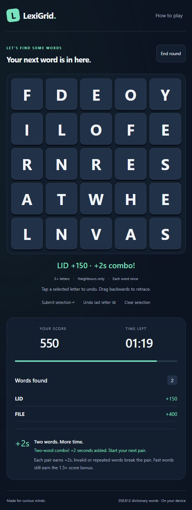

# LexiGrid

A timed word-grid puzzle with a Unity/C# core, custom Trie and MinHeap, QA documentation, and a locally playable browser preview.

Connect neighbouring letters horizontally, vertically or diagonally. Find distinct words before time runs out, correct your selection by retracing, and earn extra time with quick two-word combos.

## Play locally

With Node.js available, run from the repository root:

```powershell
./Start-Game.ps1
```

Then open **http://127.0.0.1:8765/** and choose **Play a round**. The launcher starts a localhost-only server; no npm packages or cloud services are needed. On other platforms, run `node Play/server.mjs` and open the same address.

This is a **JavaScript browser preview, not a Unity WebGL export**. It uses the project's real 358,612-word dictionary and mirrors the Trie validation, neighbouring-tile rules, length/speed scoring, board-solvability check and top-10 MinHeap. Browser settings/scores are stored in localStorage, separately from Unity PlayerPrefs/JSON.

## Controls and combo rules

- Hold and drag across adjacent letters; release to submit. Alternatively, tap tiles and use **Submit selection** or Enter. Keyboard users can activate a tile with Space.
- Tap a selected tile to remove it and every later letter. Hold and retrace to remove later letters while keeping the tile you returned to.
- **Undo last letter** / Backspace removes one letter. **Clear selection** / Escape removes the whole path. A disconnected tap starts a new path.
- Words require at least three letters. A tile cannot repeat in one path, and each word scores once per round. Rejected submissions clear automatically.
- Each non-overlapping pair of distinct valid words accepted **less than five seconds apart** earns **+2 seconds**. Invalid, too-short or duplicate submissions break the pair. Expired rounds cannot be revived.
- Existing base scores remain 100 / 400 / 800 / 1,200 / 2,000 for 3 / 4 / 5 / 6 / 7+ letters. Speed multipliers remain 1.5x below five seconds and 1.25x from five to below ten seconds.



## Run Unity

The prepared clean project targets **Unity 6000.5.10f1**. Activate an eligible Unity licence, then run:

```powershell
./Start-Game.ps1 -Unity
```

The launcher synchronizes canonical `Assets/Scripts`, `Assets/Editor`, `Assets/Tests` and `Assets/Resources` into `UnityProject/Assets`. In the editor, use **LexiGrid > Create or rebuild playable scene**, then press Play. The new builder creates `Assets/Scenes/LexiGrid.unity` and generated prefabs/resources in the staged project. The repository's existing `GameScene.unity`, legacy `AutoBuilder` and other assets remain preserved.

For a Windows executable, use `./Start-Game.ps1 -Build` after activation. The builder configures a resizable 1440 x 900 window. Native scene generation, Play Mode and the Windows build remain **unverified in this environment**: the attempted Unity build stopped because no active Editor licence was available. Compilation alone does not establish native runtime correctness or mobile readiness.

Full setup and limitations: [RUNNING.md](RUNNING.md). Complete update description: [PROJECT_UPDATES.md](PROJECT_UPDATES.md).

## Architecture

- **Trie:** exact and prefix validation; the C# implementation follows one node per letter, O(L) in word length.
- **Board generator:** English-frequency-weighted letters, DFS with Trie prefix pruning, and a guaranteed neighbouring word placement if random retries are exhausted. This guarantees a fitting word, not balanced difficulty.
- **MinHeap:** retains the best ten scores with O(log N) insertion; N is the bounded leaderboard size.
- **GameManager and event-driven input:** round state, score, timer, selection feedback, duplicate protection and combo tracking.
- **Unity UI:** CanvasGroup transitions, TextMesh Pro, square grid cells, tile reuse and desktop/tall-window reflow. Native visual/device testing is still required.
- **Browser UI:** responsive dark/mint interface, selectable paths, Web Worker dictionary loading, local settings and leaderboard.

## Verification

| Check | Latest verified result | Scope |
|---|---|---|
| C# tests | 62 passed | NUnit/Mono: 54 original cases, 3 board-fallback cases and 5 combo cases; not a Unity Editor run |
| Browser engine tests | 17 passed | Selection/retracing, combos, score boundaries, Trie, heap, adjacency, board generation and full dictionary |
| Unity source compilation | Passed | Runtime and editor assemblies; expected inspector-field warnings remain |
| Browser interactions | Checked | Invalid-word recovery, tap undo, held-mouse retracing, live combo feedback, round expiry and earlier persistence/responsive checks |
| Native player/Play Mode | Blocked | Requires licence activation and follow-up testing |

```powershell
./QA/Run-CoreTests.ps1
./QA/Compile-UnitySources.ps1
node --test Play/engine.test.mjs
```

The C# helper scripts use the installed Windows Unity/Mono toolchain; see their paths before running on another machine. Historical QA artifacts are preserved and are not represented as fresh execution results. Read [QA/Verification-2026-10-04.md](QA/Verification-2026-10-04.md) and [QA/SelectionComboRegression.md](QA/SelectionComboRegression.md) for evidence and remaining checks.
